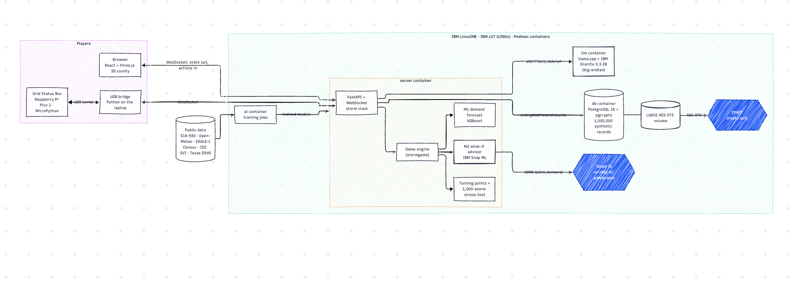
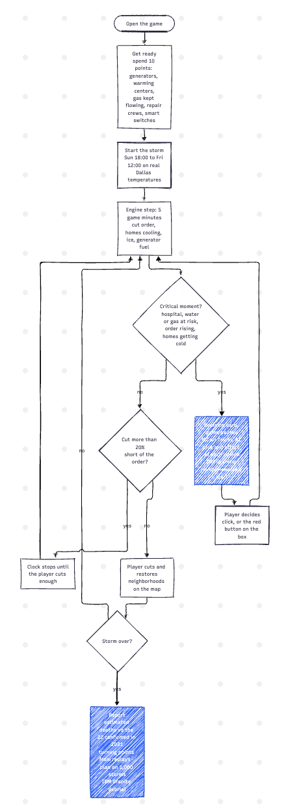
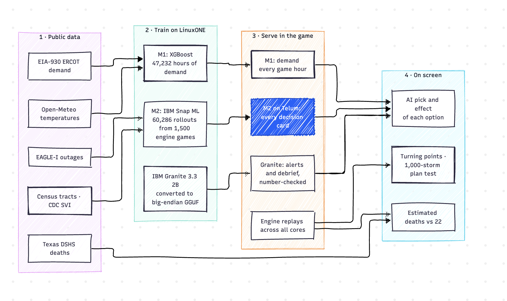

# Lights Out: architecture and solution flow

## System architecture on IBM LinuxONE

Everything that thinks runs on one IBM LinuxONE VM (IBM z17, s390x) in Podman containers. M2 runs on the Telum II on-chip AI accelerator through IBM Snap ML and zDNN, with a CPU fallback; the database volume and the customer records are encrypted with the CPACF crypto unit.

## Solution flow: one game, start to finish

The AI advises at every critical moment; the player decides. If the cut falls more than 20 percent short of the order, the clock stops until the player cuts enough, so the grid never collapses before anyone can react.

## From public data to real-time AI

Mermaid sources: [architecture.mmd](diagrams/architecture.mmd) · [solution-flow.mmd](diagrams/solution-flow.mmd) · [data-ai-pipeline.mmd](diagrams/data-ai-pipeline.mmd) (paste into https://mermaid.live to edit).
